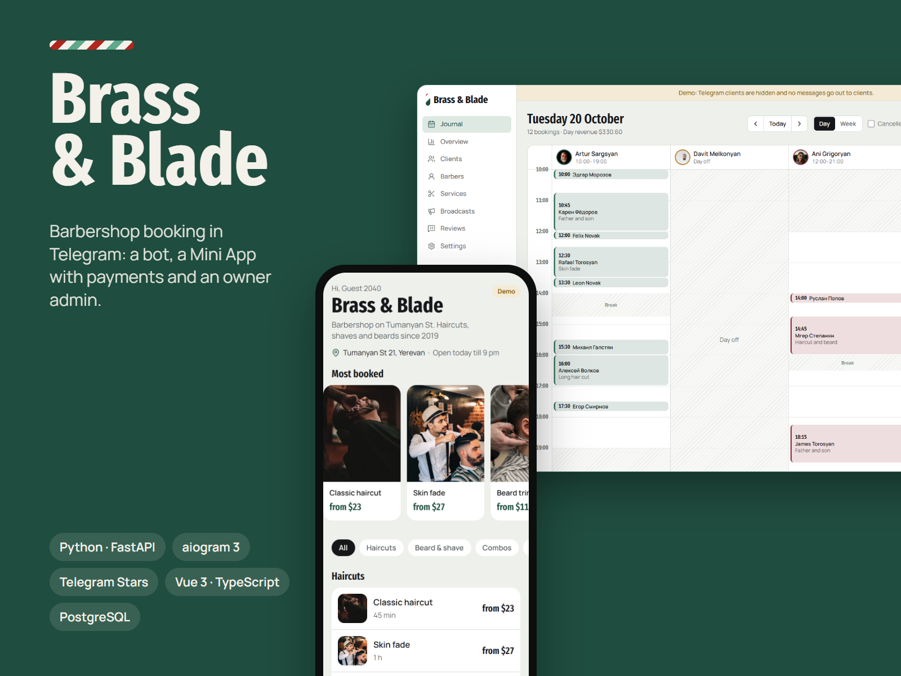
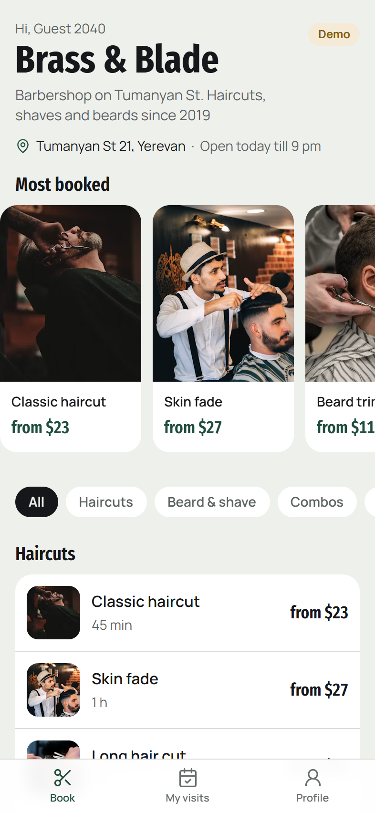
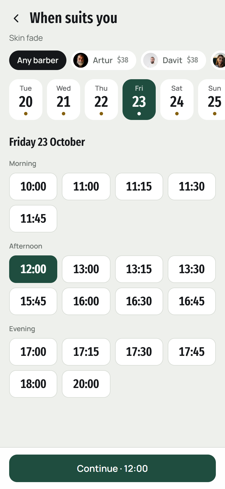
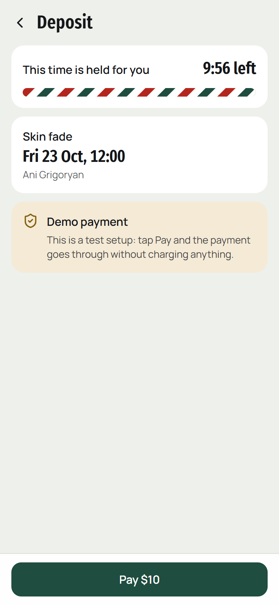
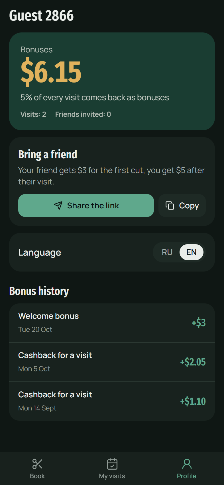
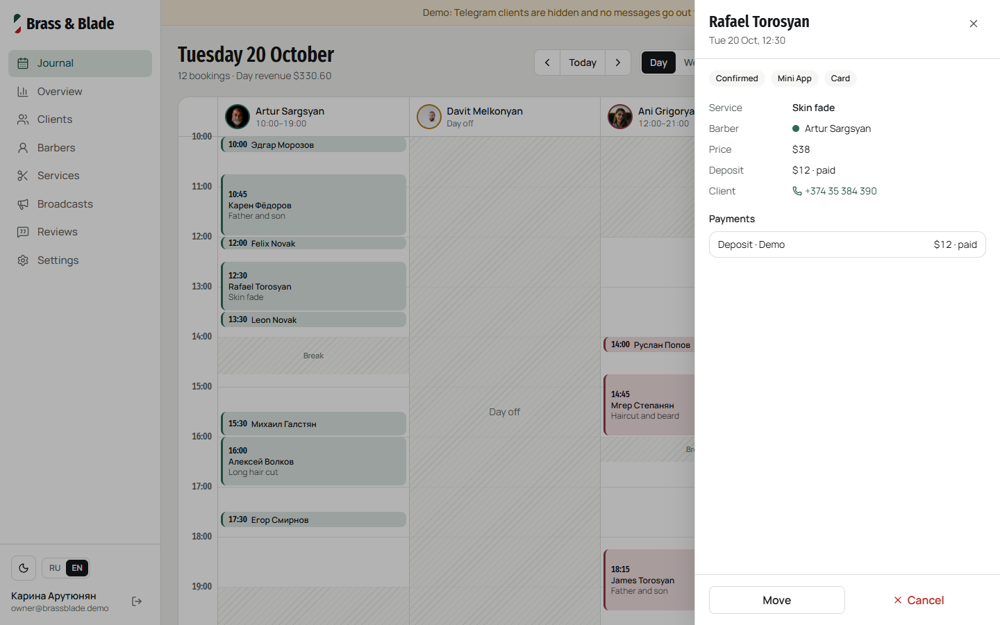
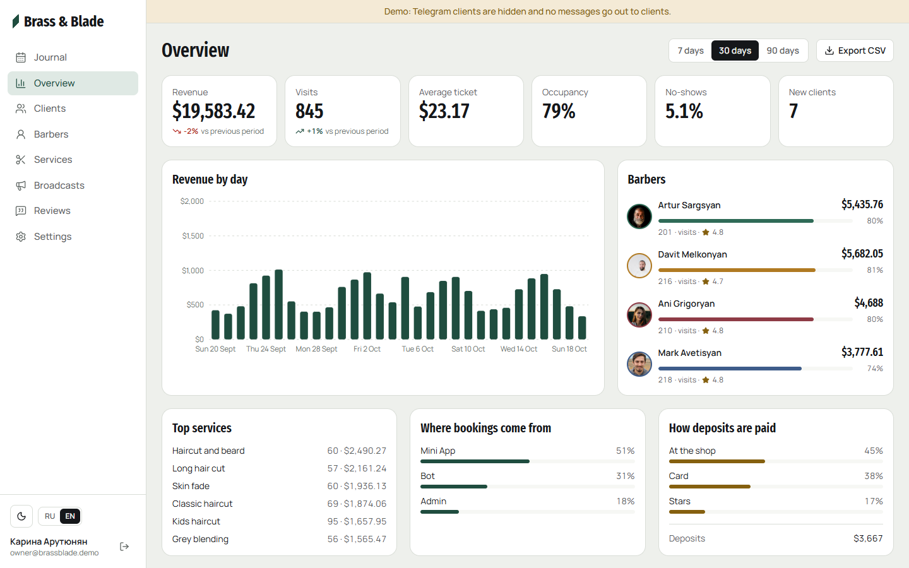

# Brass & Blade: Telegram booking bot, Mini App and admin

Online booking for a small service business that lives inside Telegram. Clients pick a service, a barber and a free slot, pay a deposit in Telegram Stars or by card, and get reminders. The owner runs the schedule in a web admin and sees revenue and barber load.

The demo is a made-up barbershop in Yerevan with four barbers, 13 services, 700 clients and two and a half months of history.

**Live demo:** [booking.narcisbin.com](https://booking.narcisbin.com) · bot [@bookingnarcisbinbot](https://t.me/bookingnarcisbinbot) · [Mini App in the browser](https://booking.narcisbin.com/app/) · [admin](https://booking.narcisbin.com/admin/) (one-click demo login). Card payments are test ones; Stars deposits cost one Star and come back when you cancel in time.



| Catalogue | Time board | Deposit | Bonuses, dark theme |
| --- | --- | --- | --- |
|  |  |  |  |





## What it does

**Bot (aiogram 3)**
- Booking with buttons: category → service → barber or "any free barber" → day → time → summary.
- Deposit by card (Telegram invoice with a Stripe or YooKassa test token) or in Telegram Stars. In demo mode without a payment token the bot shows a test payment button.
- My bookings: move or cancel. Free changes until 3 hours before the visit; a late cancellation keeps the deposit.
- Reminders a day before and 2 hours before, a review request after the visit, tips in Stars for a good review.
- Waitlist: when a slot frees up, everyone waiting for that day gets a message.
- Barbers link their Telegram with a one-time link and get new bookings, moves and cancellations; `/today` lists their day.
- Bonuses: cashback after every visit, a welcome bonus, a referral link that pays the friend who invited.

**Mini App (Vue 3)**
- Catalogue with photos and prices, barber profiles with ratings.
- Time board: a strip of days and a grid of free times, grouped into morning, afternoon and evening.
- Deposit checkout through `openInvoice`, a hold timer while the slot is reserved, a calendar file after booking.
- My visits, moving and cancelling with the same rules, reviews, bonus balance, referral sharing.
- Native feel: Telegram theme, MainButton and BackButton, haptics, fullscreen on phones, safe areas.
- Opened outside Telegram it runs as a demo with a fresh guest account.

**Admin (Vue 3)**
- Day journal with barbers in columns, shifts, breaks, time off and a "now" line; week view.
- Booking card: came, no-show, cancel with a refund, move to another time or barber.
- Phone bookings in a click on an empty spot of the journal, off the 15-minute grid if needed.
- Overview: revenue, visits, average ticket, occupancy, no-show rate, revenue by day, barber load, top services, booking sources.
- Clients with segments and search, visit history, manual bonus adjustments, notes.
- Barber schedules by weekday with breaks, own prices per service, holidays.
- Broadcasts to segments (lapsed clients, new clients, a barber's regulars), CSV export, booking rules.

## How it is built

```
backend/            Python 3.12, one package, three processes
  src/booking/
    domain/         slot maths and money/cancellation rules, no I/O
    services/       use cases: booking, payments, waitlist, reports, broadcasts
    infra/          SQLAlchemy models, Telegram and Stripe adapters
    api/            FastAPI: Mini App API, admin API
    bot/            aiogram 3 dispatcher and handlers
    worker/         notification outbox, holds, visit closing, nightly demo reset
web/                Vite + Vue 3 + TypeScript + Tailwind v4
  src/miniapp/      Telegram Mini App
  src/admin/        admin
docker-compose.yml  postgres, redis, migrations, api, bot, worker, web (nginx)
```

The API, the bot and the worker share one service layer, so a booking made in the bot, the Mini App or the admin goes through the same checks. Double booking is stopped twice: bookings of one barber are serialised with a Postgres advisory lock, and an exclusion constraint on `tstzrange(starts_at, ends_at)` rejects any overlap that gets past the code. A test fires twelve parallel requests at one slot and expects exactly one booking.

Messages to clients and barbers go through an outbox table. The worker sends due rows with `FOR UPDATE SKIP LOCKED`, retries network errors and gives up on blocked bots. Reminders survive restarts, and a review request waits until the visit is closed. Times are stored in UTC and shown in the shop's time zone. Payments go through one `PaymentService`: Stars use `refundStarPayment`, card deposits go back through the Stripe API when a key is set.

**Stack:** Python 3.12, FastAPI, aiogram 3, SQLAlchemy 2 (async), Alembic, PostgreSQL 17, Redis, Pydantic, Vue 3, TypeScript, Vite, Tailwind CSS 4, TanStack Query, vue-i18n, Docker, GitHub Actions.

## Run locally

You need Docker. A bot token is optional: without it the API, the Mini App demo and the admin still work.

```bash
cp .env.example .env
docker compose up --build
```

- Landing: http://localhost:8087
- Mini App in the browser: http://localhost:8087/app/
- Admin: http://localhost:8087/admin/ (the "Open the demo" button signs you in)
- API docs: http://localhost:8087/api/docs

The `migrate` container applies migrations and loads the demo shop on the first start.

### With a Telegram bot

1. Create a bot with [@BotFather](https://t.me/BotFather) and put the token into `BOT_TOKEN`, the username into `BOT_USERNAME`. Start the stack with the bot: `docker compose --profile bot up -d`.
2. For card deposits: BotFather → Bot Settings → Payments → Stripe TEST or YooKassa TEST, then put the token into `PAYMENT_PROVIDER_TOKEN`. Stars need no setup.
3. Telegram opens Mini Apps over https only. Serve the web container behind https and set `PUBLIC_URL`, then set the Mini App URL in BotFather to `https://your-domain/app/`.

### Development without Docker

```bash
docker compose up -d db redis
cd backend
uv sync
uv run alembic upgrade head
uv run python -m booking.seed
uv run uvicorn booking.api.app:create_app --factory --port 8017 --reload
uv run booking-bot        # in another terminal, needs BOT_TOKEN
uv run booking-worker     # in another terminal

cd web
npm install
npm run dev               # http://localhost:5177, proxies /api to :8017
```

### Checks

```bash
cd backend && uv run ruff check . && uv run mypy src tests && uv run pytest
cd web && npm run lint && npm run typecheck && npm test && npm run build
```

Backend tests run against a real Postgres (`TEST_DATABASE_URL`, a `booking_test` database is created automatically). The bot tests feed fake updates into the real dispatcher and check what it would send to Telegram.

## Demo mode

`DEMO_MODE=true` is meant for a public demo and nothing else:

- the card option falls back to a fake checkout when there is no payment token;
- the admin has a one-click owner login, and the seed creates that account;
- visitors of the Mini App in a browser get a guest account with a couple of past visits;
- real Telegram users are masked in the admin, barber link tokens are hidden, and admin actions do not message clients;
- broadcasts only count the audience;
- the worker deletes guests after a day and reloads the demo shop every night at 4:00 shop time.

Turn it off for a real business: then demo payments and the seed are refused, and `JWT_SECRET` must be a real secret. Create the owner account with `docker compose run --rm api python -m booking.cli create-admin owner@example.com "Owner Name"`.

## Photos

Service and barber photos are from [Unsplash](https://unsplash.com/license) and are loaded from their CDN.
